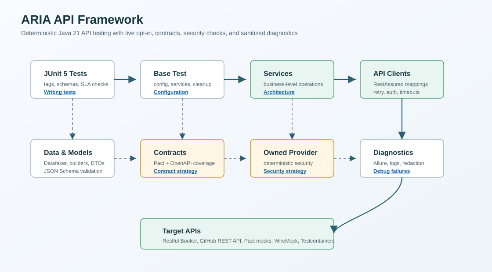

# ARIA API Framework Architecture



## Layers

Tests call service objects, service objects orchestrate API clients, and API clients own RestAssured endpoint mappings, retry behavior, timeout configuration, pluggable authentication strategies, logging, and sanitized Allure diagnostics. Models and builders keep payload construction typed and reusable.

```text
JUnit tests -> services -> clients -> RestAssured -> target API
       |          |          |
       |          |          +-- timeout config, retry, auth strategies, logging, Allure diagnostics
       |          +-- token orchestration and response DTO extraction
       +-- data factories, schemas, tags, and contract/mocking tests
```

## Configuration

`ConfigManager` loads `EnvironmentConfig` from system properties, environment variables, and `src/main/resources/config/${env}.properties`. Runtime code uses `ConfigManager.defaults()` while tests and owned-provider scenarios can create isolated managers or pass `FrameworkConfig` directly. Secrets belong in environment variables or CI secrets, not in committed config files. Startup validation fails fast for unsupported environments, malformed URLs, missing live credentials, and invalid timeout/retry values.

## Test Data

Request builders provide valid defaults. Datafaker-backed factories expose named valid, invalid, edge-case, and security-oriented payloads so tests describe scenarios without duplicating JSON construction.

## Reporting

All API clients use the same bounded structured snapshot for safe console summaries and Allure request/response/failure attachments. Raw REST Assured URI and validation-failure logging is disabled. Snapshots omit URL userinfo, query values, cookies, unapproved headers, and unsupported bodies; supported JSON is parsed and sensitive-key values are replaced recursively. The legacy mixed-text fallback omits the whole message when it detects a sensitive signal. This protects the named formats and fields; tests should still use synthetic data because arbitrary secrets embedded in ordinary text cannot be identified reliably. Test classes use Allure epic, feature, story, display names, and JUnit tags to make CI reports navigable.

## Test Execution Strategy

The default Gradle `test` task excludes `live` tests and runs deterministic mock, contract, config, security, and OpenAPI coverage checks. Public API tests are tagged `live` and run through `liveTest` only when credentials and network access are intentionally supplied.

## Contract Coverage

OpenAPI subset files under `src/test/resources/openapi` are mapped to tests through `endpoint-test-coverage.csv`. The `openApiCoverageReport` task writes `build/reports/openapi-coverage.md`, validates that every referenced test class and method exists, checks operation IDs, path parameters, request schemas, response statuses, and response schemas, and separates default-CI coverage from live-only coverage.

## Extensibility

To add a new API domain, add configuration keys, a typed client, an `AuthStrategy`, a service object, request/response models, a data factory, OpenAPI contract definitions, endpoint coverage mapping, and tests tagged by execution purpose.
