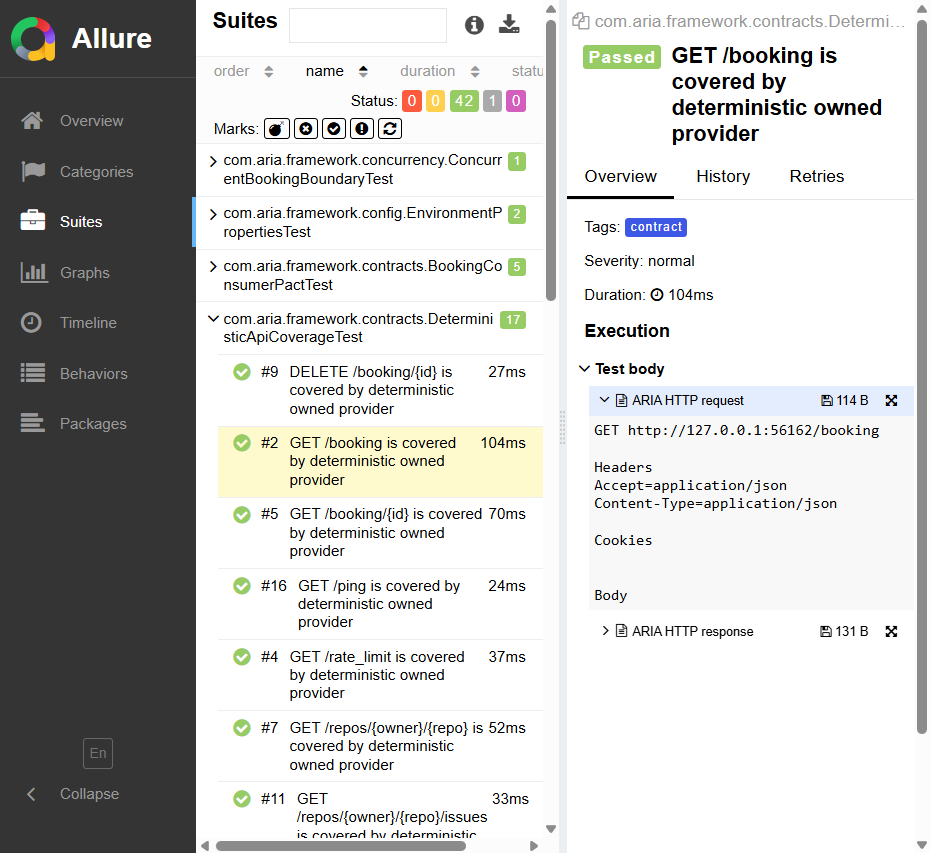

# Failure Example and Triage

The screenshot below shows a sanitized Allure diagnostic attachment. Structured snapshots omit URL userinfo, query values, cookies, unapproved headers, and unsupported bodies; supported sensitive JSON fields are redacted before logging or attachment. This is a bounded policy for known formats, so use synthetic data in tests and do not rely on it to identify arbitrary secrets in ordinary text.

## Triage Steps

1. Open the failed test in Allure and confirm the test tag and target environment.
2. Compare the response status, headers, and sanitized body with the expected contract.
3. Check `build/logs`, JUnit XML, and the OpenAPI coverage report for correlated failures.
4. Re-run the narrow test class without changing retry settings.
5. Classify the failure using the reliability policy and create an owned issue if quarantine is required.

Never paste raw credentials, cookies, authorization headers, or unredacted response bodies into an issue.
